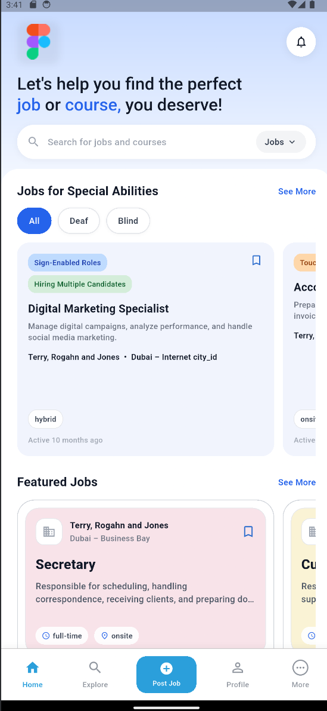
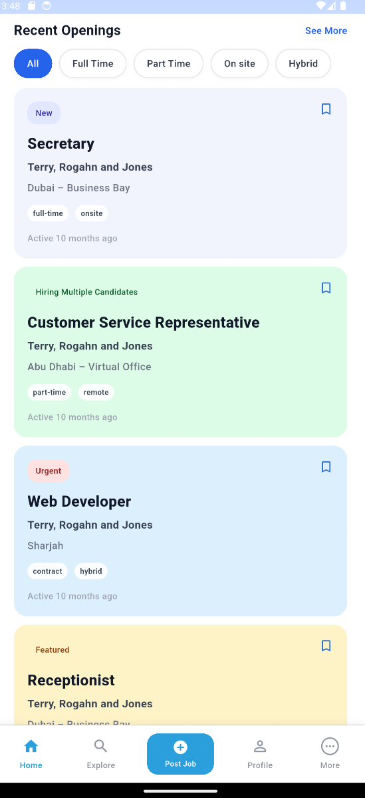
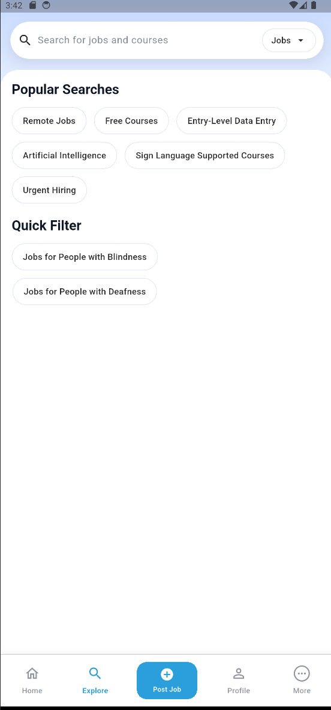
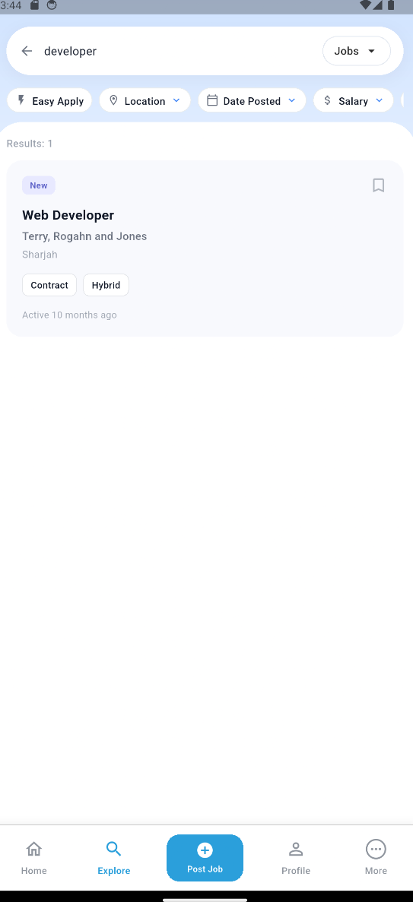
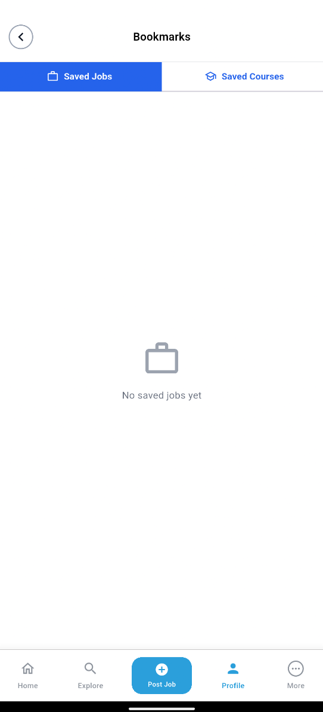
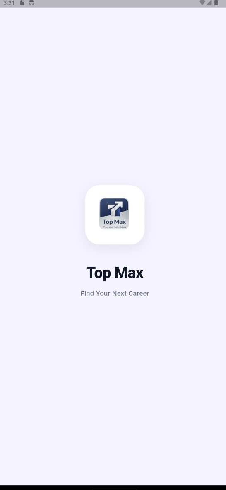
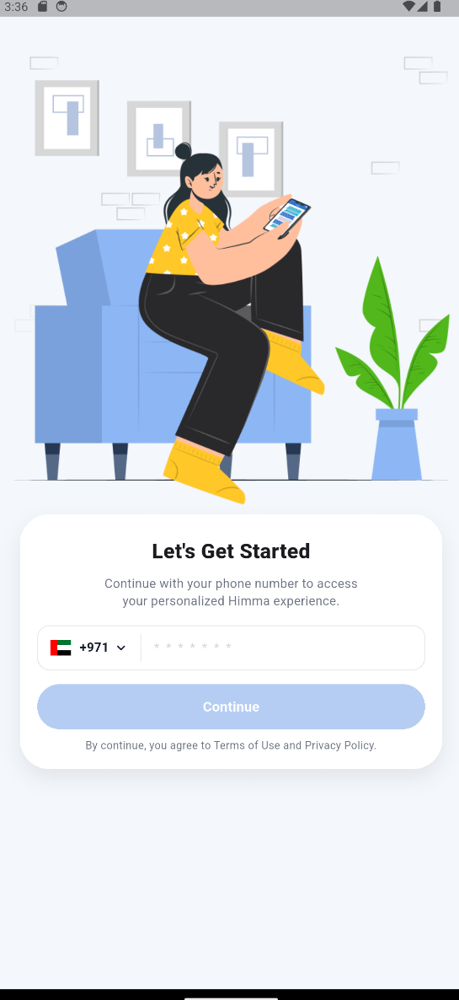
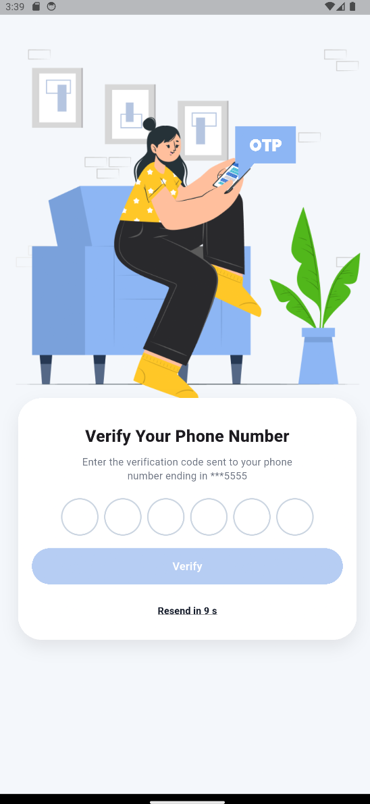

# Top Max — Flutter Job Search & Career Platform

**A Flutter mobile application prototype for job discovery, career exploration, and accessible employment opportunities.**

Developed as a technical assessment project to demonstrate practical Flutter development skills, REST API integration, BLoC state management, and responsive mobile UI design.

**Project Type:** Technical Assessment / Portfolio Showcase  
**Platform:** Flutter — Android & iOS project configuration  
**Status:** Functional Prototype / MVP  
**Source Code:** Private — This repository contains project documentation and screenshots only.

---

## About the Project

Top Max is a Flutter-based career discovery application designed to help users explore job opportunities and career-related courses through a mobile interface.

The application features job listings, search and filtering interfaces, saved jobs and courses, and a demo phone-based authentication flow.

One of the project's distinguishing aspects is its focus on **inclusive employment discovery**, with dedicated job categories and search filters for people with hearing or visual disabilities.

The application integrates with a REST API testing environment using demonstration data and was developed as a technical assessment rather than a production-released product.

## Main Features

- **Job Discovery:** Browse featured jobs, recent openings, and specialized employment opportunities.
- **Search and Filtering:** Search for jobs with filter interfaces for location, date posted, salary, and other criteria.
- **Inclusive Job Exploration:** Dedicated discovery sections and quick filters for people with hearing or visual disabilities.
- **Course Discovery:** Course listings and course-related API integration.
- **Saved Items:** Bookmark jobs and courses through API-connected flows.
- **Demo Authentication:** Phone number entry, six-digit demo OTP verification, registration flow, and session persistence.
- **Responsive UI:** Custom job cards, badges, horizontal lists, and adaptive layouts.
- **Loading and Error Handling:** BLoC-managed states for API-driven content.

Some features are partially implemented, and not all search filters or course-related views have been fully validated.

## App Screenshots

### Job Discovery

| Home | Recent Openings | Explore |
|:---:|:---:|:---:|
|  |  |  |

### Search and Saved Items

| Search Results | Saved Items |
|:---:|:---:|
|  |  |

### Authentication and Branding

| Splash | Phone Login | OTP Verification |
|:---:|:---:|:---:|
|  |  |  |

*Screenshots were captured from the Flutter application using demonstration data. Certain UI elements and screens remain part of the assessment prototype.*

## Tech Stack

| Technology | Usage |
|---|---|
| Flutter & Dart | Cross-platform application development |
| flutter_bloc | Event-driven state management for home, search, and saved items |
| Equatable | State equality and comparison |
| Dio | REST API communication and HTTP interceptors |
| REST API | Job listings, search, courses, saved items, and demo authentication |
| SharedPreferences | Local session token and application data storage |
| Material Design | UI components, navigation, and custom layouts |
| JSON Models | Parsing and representing backend responses |

## Architecture

The project follows a **feature-based architecture**, separating application features into UI, state management, models, and data-access components.

```text
lib/
├── main.dart
├── core/
│   ├── network/
│   └── storage/
├── features/
│   ├── auth/
│   │   ├── data/
│   │   ├── models/
│   │   └── ui/
│   ├── home/
│   │   ├── bloc/
│   │   ├── data/
│   │   ├── models/
│   │   └── ui/
│   ├── shell/
│   └── splash/
└── app/
    └── assets/
```

### Data Flow

```text
Flutter UI
    |
    v
BLoC (Events / States)
    |
    v
Repository
    |
    v
API Service (Dio)
    |
    v
REST API
```

The home, search, and saved-items features use BLoC for asynchronous data and state transitions. Authentication screens use local widget state where appropriate.

The application also uses an `IndexedStack` to maintain the main navigation sections.

## Technical Highlights

### REST API Integration

Implemented API communication using Dio, including Bearer token injection, network error handling, and structured repository-based data access.

### BLoC State Management

Organized the home feed, search functionality, and saved items using dedicated BLoCs, events, and states.

### Optimistic UI Updates

Implemented optimistic bookmark state updates with rollback handling when an API operation fails.

### Pagination

Added pagination-related state and logic for search results and saved items.

### Responsive Flutter UI

Built adaptive layouts using techniques including `MediaQuery`, `LayoutBuilder`, and reusable UI patterns.

### Inclusive Job Discovery

Implemented interfaces for specialized employment categories, including job discovery for people with hearing and visual disabilities.

## Project Status and Limitations

Top Max is a **technical assessment prototype**, not a published production application.

- Core job browsing, search, demo authentication, and bookmark flows are implemented.
- The backend uses a testing environment with demonstration data.
- OTP verification is a demo flow rather than a production SMS authentication service.
- The Post Job feature is a placeholder.
- The navigation item labeled Profile currently opens the saved-items interface rather than a completed profile page.
- The More section contains basic actions such as logout and cache clearing.
- Automated tests and production release verification were not completed as part of the documented audit.
- Android and iOS configuration files are present, but release builds have not been independently verified.

## My Role

**Flutter Application Developer — Technical Assessment Project**

My development work included:

- Developing Flutter screens and application navigation.
- Implementing the phone-based demonstration authentication flow.
- Integrating REST API endpoints for employment and career-related content.
- Organizing application features using a modular structure.
- Implementing BLoC-based state management for data-driven screens.
- Building searchable job interfaces, saved-items functionality, and responsive UI components.
- Working with API response models, HTTP requests, and asynchronous UI states.

This project demonstrates my practical approach to Flutter application development, UI implementation, state management, and API integration.

## Source Code and Privacy

This is a **public portfolio showcase repository**.

The original Flutter application source code is maintained separately and is not included in this repository.

The repository is intended to present the application concept, actual implemented functionality, technical structure, and selected screenshots.

No production credentials, private authentication tokens, or proprietary backend source files are included.

## Developer

**Eyad Taha**  
Flutter & Mobile Application Developer

GitHub: [github.com/Eyad5](https://github.com/Eyad5)

---

*Top Max — Flutter Technical Assessment & Portfolio Showcase*
